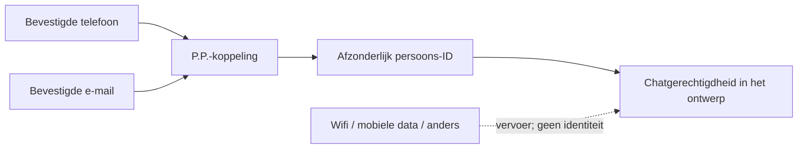

# P.P.-koppeling en chattoelating via een bevestigd contactadres

Status: **DRAFT / DESIGN_ONLY**. Echte chat, provider- en accountaansluitingen
blijven gesloten. Geen merge of uitrol uitgevoerd.

## De bevestigde gebruikersregel

Op 16 oktober 2026 heeft de gebruiker de volgende ontwerpkeuzes bevestigd:

1. Een bevestigd telefoonnummer wordt aan het individuele persoons-ID gekoppeld.
2. Het P.P.-nummer blijft aan het ID verbonden bij wifi, mobiele data of een
   andere internetverbinding; een e-mailadres kan ook aan die koppeling hangen.
3. Een **bevestigd e-mailadres mag eveneens chattoegang geven**.

De regel voor deze modelproef is daarom:

> Een actuele, bevestigde telefoon- **of** e-mailkoppeling aan het eigen
> individuele ID via diens P.P.-referentie geeft chatgerechtigdheid in het
> ontwerp. De gebruikte internetverbinding bepaalt die identiteit niet.

Dit is een functionele modelregel voor chattoelating, niet alleen een
mogelijkheid om een contactverzoek te formuleren. De uitvoering van een
concreet gesprek blijft afzonderlijk: de gesprekspartner, diens toestemming,
de afgesproken scope en de actuele uitvoeringscontroles worden niet door
contactregistratie vervangen.

## Persoon, P.P., contactadres en verbinding

Een gezamenlijk PALACO-groeps- of project-ID blijft samenwerkingscontext,
geen vervanging voor de afzonderlijke actor. Een ander groepslid krijgt geen
toegang door het nummer, adres, bewijs of de sessie van de eerste persoon
over te nemen.

De P.P.-referentie is in deze draft alleen een opaque fictieve verwijzing.
Er worden geen echte P.P.-nummers uitgegeven en geen canoniek nummerformaat,
wereldwijde uniciteit of overdrachtsprocedure aangenomen. De bestaande
[`ppRegistration: UNKNOWN`](../contact-source-binding.json) blijft
ongewijzigd; de nieuwe gebruikersregel is geen bewijs van een reeds werkend
P.P.-register of een 5CRIPTIE-contract.

De provider van de individuele aanmelding, de verifier van het contactadres
en een mobiele operator zijn verschillende rollen. Een gekozen operator,
wifi-naam, IP-adres of verbindingssoort is geen verificatiebewijs. De tests
gebruiken uitsluitend fictieve telefoon-, e-mail-, P.P.- en persoonsreferenties,
geen adressen, nummers of hashes van werkelijke contactgegevens.

## Wat de code controleert

De afzonderlijke module
`ambassades/auth/contact-eligibility-design.mjs` gebruikt de bestaande
identity-designmomentopname en een nieuwe fictieve P.P./contactregistratie.
De actor volgt uit de individuele modelsessie. De actuele P.P.-koppeling,
contactkoppeling en groepsrelatie moeten bij die actor passen.

Een clientvlag zoals `verified: true` is niet genoeg. De modelverifier
controleert een echte Ed25519-handtekening op een compact testbewijs, met een
vooraf ingestelde publieke testsleutel. De sleutel wordt bij de checkeropzet
vastgelegd en kan niet via een verzoek of bewijs worden gekozen. Het bewijs
moet het vaste beleid en doel, de juiste persoon, P.P.-referentie, sessie,
providerprincipal, samenwerkingscontext, contactsoort, contactreferentie,
challenge en actuele bindingsversies bevatten.

Alleen `PHONE` of `EMAIL` kan matchen. Niet bevestigd, ingetrokken, verlopen,
toekomstig, verkeerd ondertekend of verouderd bewijs geeft geen
chatgerechtigdheid in de modelproef. Een gewijzigde P.P.- of contactbinding
maakt een oud bewijs onbruikbaar. Elke beoordeling leest de actuele
momentopname opnieuw; een eerder positief modelresultaat is geen herbruikbaar
toegangstoken. Een herbeoordeling van dezelfde persoon met dezelfde actuele
gegevens geeft hetzelfde resultaat bij `WIFI`, `MOBILE` en `OTHER`.

De fixture stelt een korte bewijslevensduur als testgrens. Dat is geen keuze
over productiesessies, hoe vaak iemand zijn adres opnieuw moet bevestigen,
of de bewaartermijn van echte registratiegegevens.

## Betekenis van de uitkomst

Een positieve uitkomst heet `designEligible`. Alle uitkomsten blijven
`DESIGN_ONLY`, `ADVISORY_HUMAN_DECISION_REQUIRED`, `canAuthorize=false`,
`canStartChat=false`, `canOpenContact=false` en `operativeAuthority=NONE`.
Er is geen runtime-capability, account, bericht of contactruimte uitgegeven.
Het advieslabel betreft de nog vereiste operationele beoordeling en activering;
de keuze voor bevestigd telefoonnummer **of** bevestigd e-mailadres is al door
de gebruiker bevestigd en wordt niet opnieuw ter discussie gesteld.

De handtekeningproeven bewijzen dat de controle de aangewezen testondertekenaar
en de opgegeven bindingen herkent. De sleutels en bewijzen worden tijdens
de test gemaakt; er is geen echte SMS, e-mail, verificatieprovider of
identiteitsinschrijving gebruikt. Zo'n synthetisch bewijs toont geen
werkelijk beheer van een telefoonnummer of e-mailadres, natuurlijke persoon,
SIM-bezit of mens achter het scherm.

De checkeropzet is uitsluitend een gecontroleerde testconfiguratie. Een
willekeurig meegeleverde publieke sleutel mag in een latere uitvoering nooit
als vertrouwde providerinschrijving worden behandeld. Dit prototype verricht
geen providerontdekking, netwerkverzoek, gegevensopslag of sleuteluitgifte.

De huidige NOVA-receptiekeuze, veiligheidscontrole, ambassadezetelbinding,
bilaterale instemming en E2EE worden niet als vervangend contactbewijs gebruikt
en niet door deze module geopend. Historische actor- of toestemmingsrecords
worden niet veranderd bij een nieuwe contactkoppeling.

## Verificatie en vervolgbesluiten

De NOVA-receptie toont de gekozen regel in drie stappen en een uitlegvoorbeeld
met telefoon, e-mail en verbinding. Dit voorbeeld vraagt geen contactgegevens,
verstuurt niets en voert geen verificatie uit. Een andere keuze wist de vorige
voorbeeldconclusie. De downloadbare RIO-app bevat dezelfde uitleg in alle elf
bestaande talen en houdt die ook offline beschikbaar.

De serviceworker gebruikt cacheversie 3 met dezelfde vier publieke bronnen.
Een update wacht tot bestaande appvensters gesloten zijn. Browserproeven
controleren de wachtende update, behoud van lokale contacten en een
onverwante cache, verwijdering van de oude RIO-cache en de bijgewerkte uitleg
na een echte offline herstart. Er zijn geen API-routes aan de cache toegevoegd.

Lokale controles: 75 auth-unitproeven (waaronder 16 voor dit contactmodel),
11 bestaande identiteitsproeven, 22 receptie-browserproeven en 28
app-browserproeven geslaagd. De schermcontrole omvat 320, 390 en 1440 pixels
en verdubbelde basistekst zonder horizontale overloop. Dit zijn lokale
browserproeven; er is geen fysieke telefoon of externe verificatiedienst getest.

De unitproeven maken echte tijdelijke ondertekeningen en controleren onder
meer telefoon of e-mail, netwerkonafhankelijkheid, bewijsverwisseling,
vervalsing, intrekking, verlopen bewijs, verkeerde doelen en oude
bindingsversies. De bestaande HTTP-proeven controleren dat de nieuwe bronnen
en fixtures niet openbaar worden aangeboden. CI voert daarnaast de bestaande
OIDC/TLS-, browser- en containercontroles uit.

Nog te kiezen en werkelijk aan te sluiten: de vertrouwde verificatiedienst,
de afhandeling van telefoon- en e-mailbevestiging, de feitelijke P.P.-registratie,
wijziging en herstel, privacy/retentie, het actuele autorisatiebeleid en de
chatuitvoering. Registratie als contactfactor wordt geen bewijs van
wereldwijde persoonsuniciteit of recht om namens een ander te handelen.
