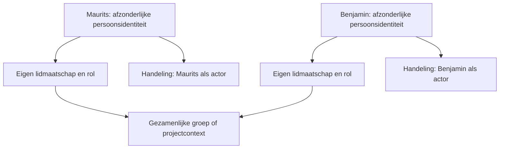

# Afzonderlijke personen, gezamenlijke PALACO-context

Status: **DESIGN_ONLY — ADVISORY_HUMAN_DECISION_REQUIRED**.
Dit is het reviewbare voorstel bij de gebruikersinstructie van 16 oktober
2026. Het aanbevolen groepsmodel is uitgewerkt, maar een definitieve
menselijke keuze, ID-uitgifte en GitHub OAuth-activering zijn niet uitgevoerd.
De aangeleverde adviesclassificatie `CONDITIONAL GO` is geen uitvoeringstoestemming.
`NO AUTHORITY WITHOUT PROVENANCE` blijft de beoogde grens; deze modelproef
levert nog geen operationeel bewijs van menselijke herkomst.

## Het voorgestelde onderscheid

Maurits en Benjamin kunnen samenwerken onder één gezamenlijk PALACO-ID,
terwijl iedere persoon een afzonderlijk PALACO-Person-ID behoudt. Hun namen
zijn hier alleen de aangeleverde samenwerkingscontext. Er zijn geen echte
persoons-ID's, GitHub-gebruikers-ID's of accountkoppelingen voor hen gemaakt.



| Begrip | Betekenis in het voorstel |
| --- | --- |
| Persoon | Afzonderlijke logische actor; geen groep of gedeelde sessie |
| Groep/project | Gezamenlijke context; kan niet zelf inloggen als persoon |
| Providerbinding | Exacte combinatie van provider-namespace en stabiele providergebruikersreferentie naar één persoon |
| Sessie | Afzonderlijke verwijzing naar één persoon en diens providerbinding |
| Lidmaatschap | Relatie tussen één persoon en één groep, met eigen status en beperkte voorbeeldrechten |
| Auditverwijzing | Herleidbare modelhandeling met actor, context en tijd, zonder een sessiegeheim |

Gelijke rechten maken twee personen niet tot dezelfde actor. Een
groeps-ID vervangt geen persoons-ID, bestaande `account_id`, `owner_id`,
`tenant_id` of ambassadezetel. Het is evenmin een alias voor een huidige
synthetische account of een officiële persoonlijke identiteit.

## Wat de modelproef doet

`draft.json` bevat uitsluitend fictieve `TST-`-referenties. De pure module
`reference.mjs` controleert een begrensde momentopname en een voorgestelde
modelhandeling. Zij importeert geen netwerk-, bestands-, database- of
authenticatiecode en wordt niet door de webserver aangeroepen.

De module controleert de samenhang van personen, groepen, providerbindingen,
sessies, lidmaatschappen en voorbeeldontvangstbewijzen. De actie-actor wordt
afgeleid uit de gevonden modelsessie. Een aangeleverde andere actor kan die
uitkomst niet overschrijven. Een groeps-ID kan nooit als actor fungeren.

Een overeenkomst is uitsluitend **interne consistentie van dit fictieve
voorbeeld**. Alle uitkomsten, ook een overeenkomst, blijven `DESIGN_ONLY`,
`canAuthorize=false` en `ADVISORY_HUMAN_DECISION_REQUIRED`. Een overeenkomst
verifieert geen provider, handtekening, persoon, toestemming of bevoegdheid.
De JSON-records zijn aangeleverde modelgegevens; zij zijn geen vertrouwde
sessiestore en geen bewijs van een echte aanmelding.

Voor deze beperkte v0.1 heeft iedere fictieve persoon precies één
providerbinding. Dat voorkomt dat dit prototype stilzwijgend een beleid
voor meerdere accounts of het samenvoegen daarvan introduceert. Het is
geen definitieve keuze over toekomstige providerkoppelingen.

## Individueel intrekken en herleiden

De tests laten twee afzonderlijke fictieve personen onder dezelfde
samenwerkingscontext handelen. Hun modelontvangstbewijzen behouden
verschillende actorreferenties. Bij intrekken van het lidmaatschap van
persoon A matcht een volgende groepshandeling van A niet meer; persoon B
blijft als afzonderlijk lid bestaan. De personen, providerbindingen en
eerdere modelontvangstbewijzen worden daarbij niet samengevoegd of gewist.

Een modelontvangstbewijs bevat de gezamenlijke contextreferentie,
`actor_person_id`, provider- en providergebruikersreferentie, `session_ref`,
handeling, scope, tijdstip en `audit_ref`. `session_ref` is een fictieve
verwijzing, geen cookie, bearer token, CSRF-waarde of herbruikbaar
sessiegeheim. Echte auditopslag, pseudonimisering, toegang en bewaartermijnen
zijn nog te ontwerpen. Deze module levert geen append-only log,
handtekening, herstelbestendig journaal of bewijs van historische autorisatie.

De velden uit het aangeleverde voorstel zijn als volgt herkenbaar in de
modelproef; dit legt geen definitief runtime- of API-formaat vast:

| Gevraagde betekenis | Fictief modelveld |
| --- | --- |
| Gezamenlijke PALACO-context | `shared_palaco_id` |
| Afzonderlijke PALACO-persoon als actor | `actor_person_id` |
| Gebruikersreferentie van een provider | `provider` samen met `provider_user_ref` |
| Sessie als herkomstverwijzing | `session_ref`, zonder sessiegeheim |
| Handeling | `action` en beperkte `scope` |
| Tijdstip | `at_ms`, opgegeven voorbeeldtijd zonder vertrouwde klok |
| Auditverwijzing | `audit_ref` |

De opgegeven providerreferenties zijn ook fictief. Later moet een
providerkoppeling berusten op door de server gecontroleerd providerbewijs
en diens stabiele gebruikerssleutel. Naam, e-mail, displaynaam of een
gedeeld projectlabel zijn geen koppelingssleutel. Controle over een
provideraccount is op zichzelf bovendien geen bewijs van een natuurlijke
persoon of van wie fysiek achter het apparaat zit.

## Grenzen van de bestaande implementaties

- Citadel houdt in `ambassades/auth/access-policy.mjs` de bestaande
  afzonderlijke zetelbindingen intact. Deze modelproef voegt geen tweede
  persoon aan één zetel toe.
- De PALACO-accountservice op
  [`1121f495`](https://github.com/Maurits-pixe/PALACO/tree/1121f4950e1d39df0ac33d28d0abf3b620478df0/services/rio-accounts)
  blijft beperkt tot de twee bestaande synthetische actors, met afzonderlijke
  eigenaar, tenant, providerbinding, consent en intrekking. Er is geen
  SQL-migratie of wijziging aan die service.
- De basis voor deze draft is de NOVA-receptie op
  [`39d6a7c`](https://github.com/Maurits-pixe/PALACO-Citadel/commit/39d6a7c8b5388cadb392e0a957bef2f7d7aade68).
  De nieuwe modelbestanden worden niet als openbare webassets aangeboden.

Er zijn geen OAuth-app, redirect, scope, secret, echte sessie, uitnodiging,
contactroute of operationele BRI9ADE-aansluiting aangemaakt of geactiveerd.
Persoonlijke accounts en contact blijven gesloten. De gezamenlijke context
verleent ook geen impliciete toestemming om namens de andere persoon te
handelen.

## Nog te besluiten vóór activering

De mens moet het groepsmodel, de betekenis van het gezamenlijke ID en de
afzonderlijke persoonsidentiteiten beoordelen. Deze draft kiest nog geen
wereldwijd ID-formaat, provideroperator, productieassuranceniveau,
accountkoppelings- of herstelprocedure. Ook toetreden, rollen toekennen,
groepsbestuur, het beleid voor intrekken, auditbewaring en privacy staan open.

Een operationele uitvoering vereist afzonderlijk serverbewijs,
sessiebeveiliging, consent, actuele autorisatie en een transactionele controle
bij de daadwerkelijke handeling. Een oude momentopname uit deze module kan
geen latere intrekking afdwingen. De uitkomst van deze modelproef mag dus
nooit rechtstreeks worden omgezet in een runtime-capability of toegangsbesluit.

## Verificatie

Voer lokaal uit:

```text
node --test rio/identity-design/reference.test.mjs
```

CI voert de modeltests uit naast de bestaande auth-, OIDC/TLS-, browser- en
containercontroles. Testresultaten bewijzen de beschreven modelgrens; zij
vormen geen menselijke acceptatie, rolloutbesluit of toestemming voor OAuth.
